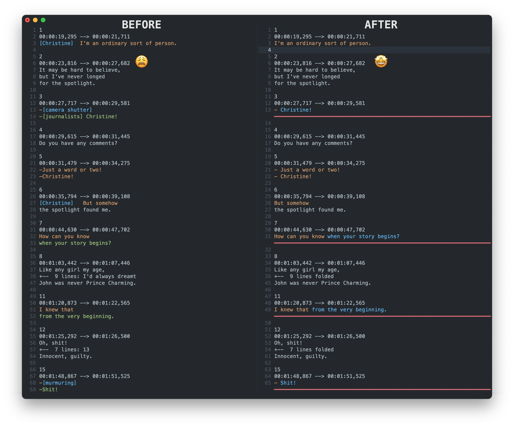

# Subclean

> Simple CLI to instantly enhance your movie & TV show subtitles.

## Installation

```
pip install subclean
```

## Example

```
$ subclean subtitle.srt
12:35:30.337 | INFO | Importing subtitle subtitle.srt
12:35:30.344 | INFO | BlacklistProcessor running
12:35:30.397 | INFO | SDHProcessor running
12:35:30.421 | INFO | DialogProcessor running
12:35:30.426 | INFO | ErrorProcessor running
12:35:30.458 | INFO | LineLengthProcessor running
12:35:30.466 | INFO | Saving subtitle subtitle_clean.srt
```



## Usage

```
usage: subclean [-h] [-v] [-V] [-o OUTPUT | --overwrite] [--processors NAME [NAME ...]] [--regex REGEX] [--line-length LINE_LENGTH] FILE [FILE ...]

positional arguments:
  FILE                  subtitle file to process

options:
  -h, --help            show this help message and exit
  -v, --verbose         increase output verbosity
  -V, --version         show program's version number and exit
  -o, --output OUTPUT   output file (single input only)
  --overwrite           overwrite input file
  --processors NAME [NAME ...]
                        processors to run, in order (default: Blacklist SDH Dialog Error LineLength Style)
  --regex REGEX         additional blacklist regex, can be repeated
  --line-length LINE_LENGTH
                        maximum length when merging short lines (default: 50)
```
